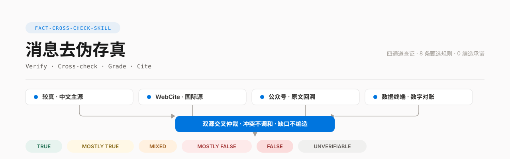

<div align="center">

<picture>
  <source media="(prefers-color-scheme: dark)" srcset="docs/assets/banner-dark.svg">
  
</picture>

# fact-cross-check-skill

### 消息去伪存真 — 四通道查证 + 甄选规则工具集

**Verify. Cross-check. Grade. Cite.**

[](LICENSE)
[](#依赖)
[](#四通道查证)
[](#甄选规则)
[](#评级量表)

**[四通道](#四通道查证) · [降级策略](#降级策略) · [甄选规则](#甄选规则) · [评级量表](#评级量表) · [快速开始](#快速开始) · [可视化预览](docs/preview.html)**

</div>

> [!IMPORTANT]
> 本 skill 只做信息核查：查得到就给证据，查不到就如实标注。**绝不编造、绝不静默降级。**

一个面向 [WorkBuddy](https://www.workbuddy.cn) / Claude Code 类 Agent 的 **Skill**：对「叙事 / 事件 / 政策 / 平台规则 / 公司声明」做结构化事实核查，输出带信源分级、评级量表与证据链的查证报告。

## 为什么需要它

转发一条消息之前，你能回答三个问题吗：**信源是谁？还有第二源吗？原文在哪？**

大量"官方说法"的原始出处是微信公众号文章，搜索引擎收录差，公开检索只能拿到转载——而各转载版本内容常有出入（实测案例：某 AI 产品销售额环比 +71% 的数据，仅一家权威媒体版本有，其他转载版均无）。本 skill 把"查证"从随口一搜变成可审计的流程。

## 四通道查证

| 通道 | 脚本 | 适用 | 失败时 |
|---|---|---|---|
| **① 腾讯较真** | `jiaozhen_cli.sh` | 中文叙事 / 传闻 / 政策主源 | 标注「⚠️ 较真不可用」，不重试轰炸 |
| **② WebCite** | `webcite_cli.sh` | 国际源补强 / 英文命题 | Key 缺失 exit=2 干净报错；429 标注额度耗尽 |
| **③ 微信公众号** | `weixin_search.sh` | 平台规则 / 官方报告的原文回溯 | 搜狗反爬拦截 → 如实标注「⚠️ 公众号通道未完成」 |
| **④ 本地数据终端** | 会话内逐点对账（无脚本） | 报告关键数字的逐条核对 | 查不到 → 如实标「❓查不到」，三档标注 |

统一入口 `verify.sh` 自动调度：中文 → 较真；英文 → WebCite；中文命题命中「报告 / 政策 / 规则 / 费率」类关键词时自动加挂微信通道回溯原文；数字密集命题走第四通道逐点对账（详见 [SKILL.md](SKILL.md) 数字类子模板）。

## 降级策略

每个通道的失败路径都是**显式声明**的，不存在静默失败：

| 故障 | 行为 | 用户看到 |
|---|---|---|
| 较真 CLI 未安装 | exit 127，不重试 | 「⚠️ 较真不可用（可选依赖未安装）」 |
| WebCite key 缺失 | exit 2 | 「⚠️ WebCite 未配置，国际源未核查」 |
| WebCite 429 | exit 4 | 「⚠️ 额度耗尽，本源未核查」 |
| 搜狗反爬拦截 | exit 3 | 「⚠️ 公众号通道未完成」 |
| 全部通道失败 | 不编造 | 「❓ UNVERIFIABLE」+ 已尝试通道清单 |

## 甄选规则

内建于查证协议，逐条可审计：

| # | 规则 | 要点 |
|---|---|---|
| 1 | **双源验证** | 每条主张至少 2 个独立来源，否则标"不可靠" |
| 2 | **168 小时窗口** | 事件须落在 `[报告日-6, 报告日]`，过期不纳入 |
| 3 | **窗口覆盖报告日** | 扫描窗口 `window_end` 必须 ≥ 报告日，否则只标「⚠️ 扫描未完成」 |
| 4 | **影响度评分** | 主题关联度 + 可核验锚点 + 事件烈度 + 验证等级，取 Top N |
| 5 | **第三源标签** | 🔴存疑 / ✅印证 / ⚪无覆盖 / ⚠️未完成超时（仅标注，不阻断） |
| 6 | **失败降级** | 单源失败只降级标注，**绝不编造、不静默丢弃** |
| 7 | **原文优先** | 公众号原文 > 权威转载 > 自媒体转述；仅有转载时标注「未回溯原文」 |
| 8 | **版本差异检查** | ≥2 家转载不一致 → 自动触发原文回溯，报告输出「版本差异」提示 |

## 评级量表

| 评级 | 含义 | 触发条件 |
|---|---|---|
| ✅ TRUE | 命题准确 | ≥2 个独立可靠来源交叉印证 |
| ⚠️ MOSTLY TRUE | 核心事实准确 | 缺重要上下文，或细节有偏差 |
| 🔶 MIXED | 真假参半 | 双源直接冲突（同时引用两源，不强行调和） |
| ❌ MOSTLY FALSE | 误导性强 | 核心事实错误但夹杂个别真元素 |
| 🚫 FALSE | 可被明确证伪 | 有官方 / 一手证据直接否定 |
| ❓ UNVERIFIABLE | 无法核实 | 单源无法核实、168h 窗口外、双源均不可用 |

## 快速开始

```bash
git clone https://github.com/marqosjiang-gif/fact-cross-check-skill.git
cd fact-cross-check-skill

# 自动选择通道：中文 → 较真；英文 → WebCite
bash scripts/verify.sh "中美关税协议已正式签署"

# 显式指定通道
bash scripts/verify.sh "The US Fed cut rates by 25bps" --source=webcite
bash scripts/verify.sh "某平台 中秋国庆消费报告 原文" --source=weixin

# 双通道交叉
bash scripts/verify.sh "某平台 商家费率调整" --source=both

# 第四通道（会话内）：把报告里的关键数字逐条对账
# 数字类子模板见 SKILL.md —— 逐点输出「✅准确 / ⚠️有出入（差 X%）/ ❓查不到」
```

## 可视化预览

打开 [`docs/preview.html`](docs/preview.html) 查看本 skill 的架构可视化页面：四通道数据流、甄选规则流水线与评级量表的图示（纯静态、零外链资源）。

## 目录结构

```
fact-cross-check-skill/
├── SKILL.md                  # 技能主文档（Agent 加载的入口）
├── test-prompts.json         # 验证用测试命题
├── scripts/
│   ├── verify.sh             # 统一入口（四通道智能调度）
│   ├── jiaozhen_cli.sh       # 腾讯较真通道
│   ├── jiaozhen_cli-state.sh # 较真 CLI 状态检查
│   ├── webcite_cli.sh        # WebCite shell 入口
│   ├── webcite_cli.py        # WebCite 流式客户端（纯标准库）
│   └── weixin_search.sh      # 微信公众号搜索通道
├── docs/
│   ├── preview.html          # 架构可视化页（纯静态）
│   └── assets/               # README 头图（亮 / 暗主题 SVG）
└── references/
    ├── sources_catalog.md    # 全信源清单（含公众号官方号层）
    └── geo_scan_schema.md    # 事件扫描输出约定
```

## 依赖

- Bash / sh、Python 3（webcite 客户端纯标准库，无需 pip）
- `tencent-news-cli`（腾讯较真通道的**可选外部依赖**；未安装时该通道降级标注，不阻断。适配其他辟谣数据库时，只需让 `jiaozhen_cli.sh` 转发的命令保持相同的 JSON 输出约定）
- WebCite API key（可选；配置方法见 SKILL.md）
- 第四通道无脚本依赖：任何能给出带出处的数字对账的本地数据工具皆可充当

## 免责声明

本工具用于**信息核查与研究辅助**，输出为信源结构化结果，不构成任何专业建议。信息请以官方披露为准。

## License

[MIT](LICENSE)
